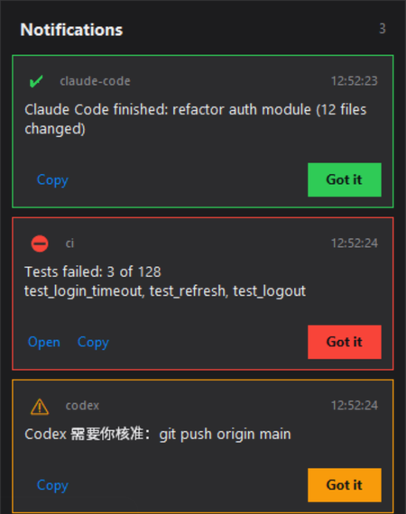

# deskpop

**A sticky desktop notification center for AI coding agents and background scripts.**
給 AI agent 和背景腳本用的「不會自己消失」桌面通知中心。



Windows toasts disappear after a few seconds. If Claude Code finished, a test run failed, or Codex is waiting for your
approval while you were making coffee, you never see it. deskpop keeps every message **on screen until you click
"Got it"**.

- Always-on-top card stack in the bottom-right corner, dark theme, rounded corners on Windows 11.
- Text is **selectable and copyable** — paste an error straight back to your agent.
- Optional **Open** button for a URL or file (CI run, report, PR).
- Levels `alert` / `warn` / `info` / `ok`, a `source` label, and `--dedup` to avoid repeats.
- Ready-made hooks for **Claude Code** and **Codex**.
- Any process can push: a cross-process locked JSON queue, written atomically — 30 parallel pushes, none lost.
- Survives `pythonw` (no console): errors go to `~/.deskpop/error.log` and the loop never dies silently.
- UI in English, 繁體中文, 简体中文, 日本語. Standard library only (tkinter), Python 3.8+.

## Quick start

```bash
python deskpop.py run                 # start the window (Windows: pythonw deskpop.py run, no console)
python deskpop.py push "Build finished" --level ok
python deskpop.py push "Tests failed: 3" --level alert --open https://ci.example.com/42 --source ci
python deskpop.py list                # pending messages
python deskpop.py clear               # dismiss all
```

```python
import deskpop
deskpop.push("Nightly backup done", level="ok", source="backup")
```

Start it at login on Windows:

```powershell
schtasks /Create /SC ONLOGON /TN deskpop /TR "pythonw C:\tools\deskpop.py run --lang zh-TW"
```

## Claude Code

`~/.claude/settings.json`:

```json
{
  "hooks": {
    "Notification": [{ "hooks": [{ "type": "command", "command": "python /path/deskpop.py claude-hook" }] }],
    "Stop":         [{ "hooks": [{ "type": "command", "command": "python /path/deskpop.py claude-hook" }] }]
  }
}
```

`Notification` (e.g. a permission prompt) shows as **warn**; `Stop` shows "Claude Code finished (project)".

## Codex

`~/.codex/config.toml`:

```toml
notify = ["python", "/path/deskpop.py", "codex-notify"]
```

Codex appends its JSON payload; deskpop shows "Codex finished: <last message>".

## Options

| | |
|---|---|
| `run --lang en\|zh-TW\|zh-CN\|ja` | UI language (or `DESKPOP_LANG`) |
| `run --max-visible 4` | cards shown at once (the counter shows the total) |
| `run --auto-ack 10` | auto-dismiss a *shown* card after N minutes (default: never) |
| `run --auto-open` | open the attached URL/file as soon as the card appears |
| `DESKPOP_HOME` | queue folder (default `~/.deskpop`) |

## Tests

```bash
python tests/test_queue.py
```

## License

MIT
